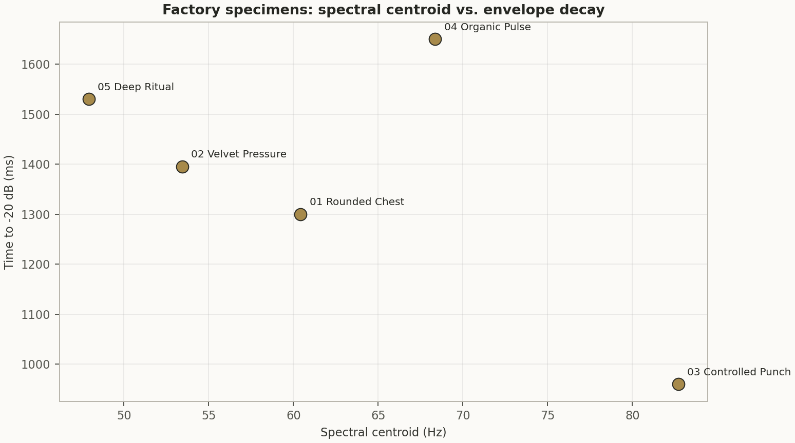

# Particula Primordial — Kick Engine / 01

**Version:** 0.2.0  
**Type:** Procedural audio instrument + signal-analysis laboratory + technical research notebook  
**Audio export:** 48 kHz, 32-bit float, mono WAV  
**Interface:** Streamlit  
**Core:** Python, NumPy, SciPy and Plotly

Particula Primordial Kick Engine is a browser-based environment for creating original kick drums, examining their measurable signal behavior, and documenting the sound-design process. It is designed around controlled low-frequency weight, rounded attack, restrained harmonics and evolving rhythmic music—not around hard-techno aggression or one-click sample selection.

## Three complementary layers

### 1. Kick Engine — generation

The synthesizer creates audio from a parameterized model:

- Start and end frequency, pitch-decay time and pitch curvature
- Body oscillator and sub component
- Weighted harmonic partials and harmonic tilt
- Tonal/noise transient, transient pitch and transient decay
- Amplitude attack and decay
- Soft saturation and output ceiling
- Deterministic rendering from a parameter set and seed

### 2. Kick Laboratory — measurement and visualization

The laboratory analyzes the last rendered kick, one of the included factory WAVs, or a user-uploaded WAV. It presents:

- Time-domain waveform
- Whole-file frequency spectrum
- STFT spectrogram showing spectral change over time
- RMS amplitude-decay envelope
- Estimated low-frequency pitch/periodicity ridge
- Frequency-band energy distribution
- Peak, RMS, crest factor, spectral centroid and decay-crossing metrics
- Factory-sample comparison table and scatter plot
- Downloadable JSON measurement report and CSV data

The plotted data is calculated from the selected audio. The low-frequency ridge is an autocorrelation-based estimate and is not guaranteed to be the true fundamental frequency for every signal.

### 3. Research Notebook — learning and documentation

The application contains an IMRaD-style technical notebook, while the `research/` directory stores the paper and supporting materials:

- `PAPER.md` — abstract, introduction, methods, results, discussion and limitations
- `EXPERIMENT_PROTOCOL.md` — repeatable parameter and listening experiments
- `EXPERIMENT_LOG_TEMPLATE.md` — blank template for new experiments
- `GLOSSARY.md` — concise explanations of signal-processing terms
- `REFERENCES.md` — books, technical documentation and metering standards
- `data/` — actual measurements computed from the included factory WAVs
- `figures/` — static charts generated from measured audio for reports and portfolio use

The initial paper figures are visible directly in GitHub and regenerated from the bundled WAVs:



**Important distinction:** the engine generates; the laboratory measures; the notebook explains and records. A spectrum can quantify frequency distribution, but it cannot prove perceived warmth, chest impact, danceability or listener preference. Those require listening in context and, for research claims, a controlled listening method.

## Run locally (optional)

Python 3.10 or newer is recommended.

```bash
python -m venv .venv
# Windows PowerShell:
.venv\Scripts\Activate.ps1
# macOS / Linux:
source .venv/bin/activate

pip install -r requirements.txt
streamlit run app.py
```

The app opens in your browser, usually at `http://localhost:8501`.

## Deploy with GitHub + Streamlit Community Cloud

You do not need to install Python locally to deploy it.

1. Create a GitHub repository named `particula-primordial-kick-engine`.
2. Upload the files and folders from this project. Keep `app.py`, `kick_engine.py`, `kick_analysis.py`, `presets.py` and `requirements.txt` in the repository root.
3. Open [Streamlit Community Cloud](https://share.streamlit.io/) and connect your GitHub account.
4. Create an app, select the repository and branch, and set the main file path to `app.py`.
5. Deploy. Streamlit reads `requirements.txt` and installs the dependencies.

## Rebuild the factory library and research figures

From the repository root:

```bash
python -m pip install -r requirements-research.txt  # optional: only for static figure generation
python scripts/regenerate_factory_library.py
python scripts/generate_research_artifacts.py
```

The optional research requirements install Matplotlib for rebuilding static paper figures. They are not required to run or deploy the Streamlit application. The first script creates the five factory WAVs and a parameter manifest from the preset definitions using fixed, documented seeds. The second script measures those WAVs and writes CSV/JSON files plus static paper figures. This keeps the paper's dataset reproducible from the included source files.

## Test the project

```bash
pip install pytest
pytest -q
```

The current tests cover deterministic synthesis, output bounds, sample length, bounded parameter variation, measured single-tone analysis, and stereo integer-PCM input.

## Project structure

```text
particula-primordial-kick-engine/
├── .streamlit/config.toml
├── examples/factory-kicks/       # Factory WAVs + manifest
├── research/
│   ├── data/                     # Measured CSV / JSON
│   ├── figures/                  # Static research charts
│   ├── PAPER.md                  # IMRaD-style technical report
│   ├── EXPERIMENT_PROTOCOL.md
│   ├── EXPERIMENT_LOG_TEMPLATE.md
│   ├── GLOSSARY.md
│   ├── REFERENCES.md
│   └── README.md
├── scripts/
│   ├── regenerate_factory_library.py
│   └── generate_research_artifacts.py
├── tests/
├── app.py                        # Streamlit interface
├── kick_engine.py                # Procedural synthesis
├── kick_analysis.py              # Signal analysis
├── presets.py                    # Factory parameter sets
├── requirements.txt
├── requirements-research.txt       # optional Matplotlib for paper figures
└── README.md
```

## Current limitations

- The synthesizer is a compact oscillator/envelope model, not a physical drum model.
- The five-sample factory dataset is a small synthetic demonstration set.
- Signal descriptors do not predict subjective quality or replace listening.
- Sample peak and RMS are not LUFS or ITU-R BS.1770 loudness measurements.
- The application does not yet perform true-peak metering, user account storage, or persistent cloud preset management.

## Planned development

1. Multi-layer synthesis and independent phase controls.
2. More detailed transient shaping and partial envelopes.
3. Kick/bass coexistence analyzer with spectrum overlay and level-matched A/B.
4. Persistent preset bank and metadata tagging.
5. Controlled listening-test workflow with separate subjective ratings.

## License

MIT. See `LICENSE`.
