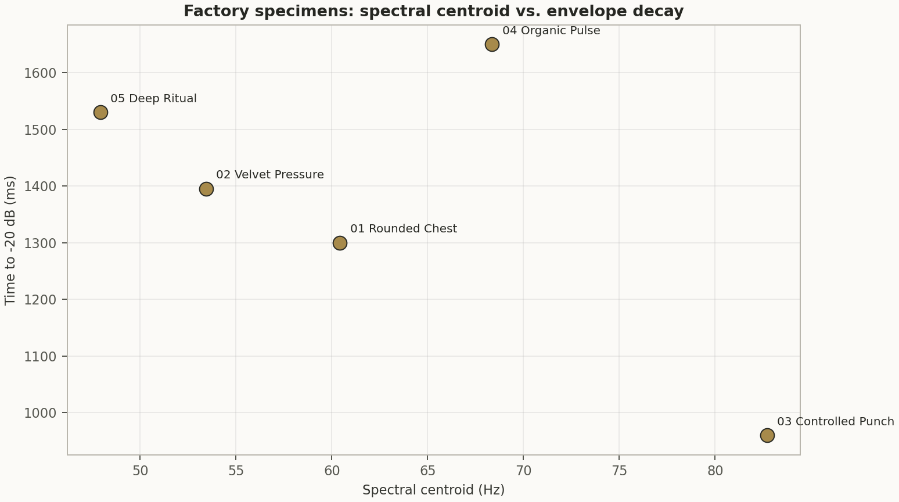
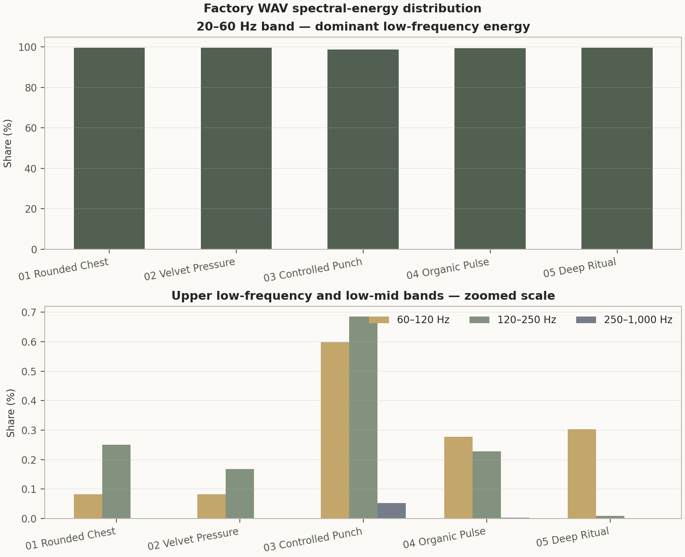
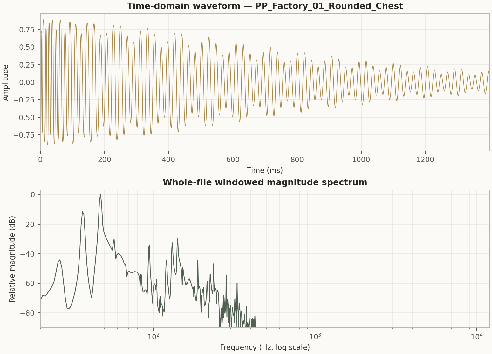
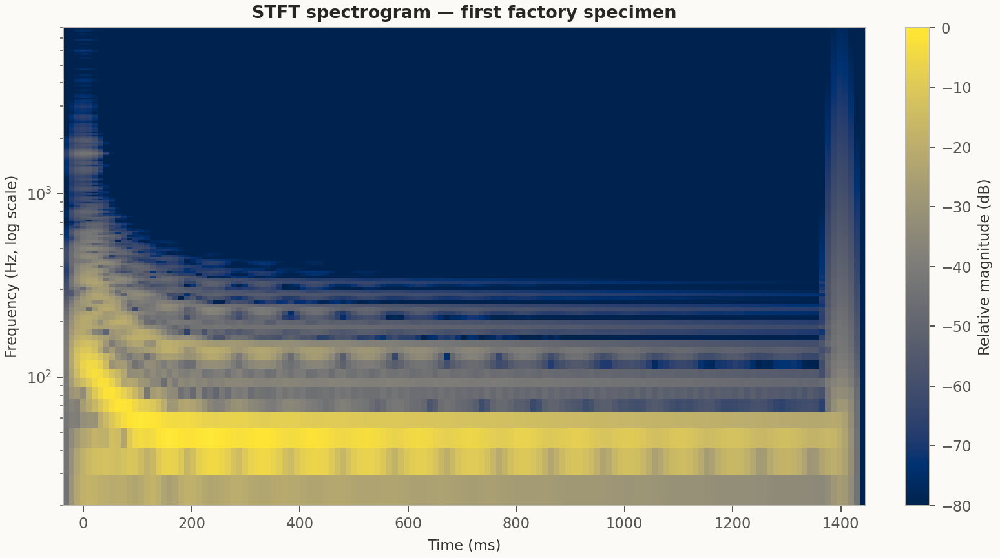

# Procedural Kick Drum Synthesis and Signal Analysis

**Project:** Particula Primordial — Kick Engine / 01  
**Version:** 0.2.0  
**Document type:** Living technical report, organized using IMRaD  
**Author:** Particula Primordial  
**Status:** Prototype and initial descriptive dataset

## Abstract

This project develops a compact, parameterized software instrument for designing low-frequency kick drums and a companion laboratory for measuring and visualizing their signal properties. The synthesis model combines a time-varying sinusoidal oscillator, a low-frequency sub component, weighted harmonic partials, a short tonal/noise transient, an amplitude envelope, and soft nonlinear saturation. The analysis module reports peak and RMS levels, crest factor, spectral centroid, spectral-band energy shares, an amplitude-decay envelope, a short-time Fourier transform (STFT) spectrogram, and an autocorrelation-based estimate of the dominant low-frequency periodic component.

The first prototype includes five factory WAV specimens. Their signal descriptors are recalculated from the audio files and exported as CSV and JSON, while waveform, spectrum, spectrogram, envelope, and comparative plots are available in the browser application. These measurements describe the digital signals; they do not establish subjective preference, perceived warmth, chest impact, or danceability. The contribution is a reproducible workflow connecting procedural audio synthesis, signal inspection, parameter documentation, and iterative sound design.

**Keywords:** procedural audio; kick drum; digital signal processing; synthesis; spectral analysis; STFT; envelope; reproducibility; sound design.

---

## 1. Introduction

A club-oriented kick drum is not defined by one parameter. Its usefulness depends on the interaction of its initial transient, low-frequency body, pitch contour, harmonic content, amplitude envelope, and relationship with the bassline. These dimensions are related but not interchangeable. A high sample peak does not guarantee sustained low-frequency energy; a large low-frequency component can consume headroom; and a visually prominent waveform does not by itself predict how a kick will translate across playback systems.

Many production workflows begin with a sample library and proceed through selection and processing. This project instead treats the kick as a parameterized signal that can be generated from a known model. Controls are intended to expose musically meaningful dimensions: start and end frequency, pitch-decay time and curvature, body/sub balance, harmonic amount and tilt, transient level and decay, amplitude attack and decay, saturation, and output ceiling.

The instrument is designed around a particular aesthetic objective: rounded, warm, controlled low-frequency weight with enough attack definition for a hypnotic, loop-based underground groove. This is a design brief, not a scientific category. The software can expose and measure properties that may contribute to that result, but listening in context remains necessary.

### 1.1 Research question

How can a compact procedural synthesis model provide interpretable control over the pitch contour, spectral structure, transient and decay of a club-oriented kick while preserving reproducibility and exposing measurable output features?

### 1.2 Subquestions

1. How do pitch-contour parameters affect the estimated low-frequency trajectory?
2. How do body, sub and harmonic parameters change the distribution of spectral energy?
3. How do attack and decay parameters affect the measured RMS envelope?
4. Which descriptors can distinguish generated specimens without pretending to predict subjective quality?

### 1.3 Objectives

- Implement a deterministic kick synthesizer whose output is reproducible from a parameter set and random seed.
- Build a browser-based laboratory that visualizes the waveform and frequency content over time.
- Export audio, parameter metadata, and analysis data in reusable formats.
- Create an auditable technical record and an experiment method that separates signal measurements from listening judgments.

---

## 2. Methods

### 2.1 Synthesis architecture

The central oscillator uses a time-varying instantaneous frequency:

\[
f(t)=f_{end}+(f_{start}-f_{end})\exp\left[-\left(\frac{t}{\tau}\right)^p\right]
\]

where \(f_{start}\) is the initial frequency, \(f_{end}\) is the terminal frequency, \(\tau\) controls the time scale of the fall, and \(p\) shapes its curvature. The oscillator phase is obtained by integrating the instantaneous frequency:

\[
\phi(t)=2\pi\int_0^t f(u)\,du
\]

The principal body component is \(\sin(\phi(t))\). A set of integer partials is added at multiples of the oscillator phase. Their relative amplitudes are controlled by a harmonic amount and a tilt parameter. A separate low sine component adds sub energy. A brief tonal/noise transient supplies attack definition. The combined signal is shaped by an amplitude attack/decay envelope and passed through a hyperbolic-tangent saturation function.

The current model is intentionally compact and computationally inexpensive. It is not a physical model of a drum membrane or enclosure.

### 2.2 Analysis architecture

The Kick Laboratory accepts the last synthesizer render, one of the factory WAVs, or a user-uploaded WAV. The selected buffer is measured directly.

| Descriptor | Operational definition | Interpretation boundary |
|---|---|---|
| Duration | Number of samples divided by sample rate | File duration, not perceived sustain |
| Peak level | Maximum absolute sample value, converted to dBFS | Sample peak; not true peak or loudness |
| RMS level | Square root of mean squared samples, converted to dBFS | Whole-file average level |
| Crest factor | Peak-to-RMS ratio in dB | Peakiness descriptor; not a quality score |
| Spectral centroid | Magnitude-weighted mean frequency | Spectral-balance descriptor, not warmth itself |
| Band-energy share | FFT power within fixed frequency bands divided by power in 20 Hz–12 kHz | Relative distribution, dependent on the analysis range and window |
| Spectrogram | Magnitude of overlapping, windowed Fourier transforms over time | Shows how spectral energy changes; window length trades time resolution against frequency resolution |
| RMS decay crossings | Time after envelope peak until smoothed RMS crosses -6, -20 or -40 dB relative to peak | Operational envelope measures, not standardized room-decay metrics |
| Low-frequency ridge | Frame-based autocorrelation estimate constrained to 25–250 Hz | Approximate periodic-component trace; may fail on transients, noisy signals or strong harmonics |

### 2.3 Reproducibility and data handling

Every render is associated with its synthesis parameters and random seed. Batch variation exports contain each WAV, its parameters, the seed and measured descriptors. The factory comparison is recalculated from the distributed WAV files at runtime. The script `scripts/generate_research_artifacts.py` rebuilds the static CSV, JSON and paper figures from the same factory dataset.

### 2.4 Software environment

The application uses Python, NumPy, SciPy, Plotly and Streamlit. The synthesis engine performs sample-level signal generation. SciPy provides the short-time Fourier transform and WAV I/O; Plotly renders interactive graphs in the application. Exact dependency constraints are listed in `requirements.txt`.

---

## 3. Results

### 3.1 Initial dataset

The initial dataset contains five factory kick WAVs rendered by this synthesis engine. The file `data/factory_measurements.csv` contains their measured descriptors. The figures below are generated from the WAV files and the computed measurements, not drawn as conceptual illustrations.

*Figure 1. Factory specimens mapped by spectral centroid and time to -20 dB. Each point is an actual WAV measurement. A longer time-to--20 dB indicates a longer measured RMS-envelope tail under the project's current method; it does not imply superior sound quality.*

*Figure 2. Factory spectral-energy shares: the upper panel shows the dominant 20–60 Hz band; the lower panel expands the smaller 60–120, 120–250 and 250–1,000 Hz bands for legibility.*

*Figure 3. Time-domain waveform and whole-file relative spectrum of the first factory specimen. This is an example signal inspection, not a target curve.*

*Figure 4. STFT spectrogram of the same factory specimen, showing the time-varying concentration of low-frequency energy.*

### 3.2 Descriptive summary of the initial specimens

Across the five factory WAVs, the measured sample peak is -1.0 dBFS for each specimen because the synthesis engine applies the same output-peak target. Whole-file RMS levels range from approximately -9.0 to -7.8 dBFS. Spectral centroid ranges from approximately 47.9 to 82.7 Hz. The measured 20–60 Hz band contains approximately 98.7% to 99.7% of the spectral power in the defined 20 Hz–12 kHz analysis range. The project's smoothed RMS envelope reaches -20 dB between approximately 960 ms and 1,650 ms after its peak.

These numbers describe this small, deliberately sub-heavy factory set. The concentration in 20–60 Hz indicates that the current presets prioritize sustained low-frequency energy; it also motivates testing an independently controlled transient/upper-partial layer in future versions. The long -20 dB crossings should be auditioned in a repeated kick/bass pattern because overlapping tails may affect low-end clarity. This is an engineering observation, not a listener-study result.

### 3.3 Results table

The machine-readable measurements are maintained in `data/factory_measurements.csv`. Use that file as the numeric source for the figures. The application also provides a live comparison table and downloadable dataset so that new WAVs can be analyzed under the same definitions.

### 3.4 Interpretation

The initial set can be compared descriptively along several dimensions: spectral centroid, low-frequency energy share, crest factor, RMS level, and envelope-decay crossings. Such descriptors help explain why two signals differ numerically and can guide further listening. They do not directly measure warmth, punch, chest sensation, groove, or listener preference.

The next useful step is a controlled parameter experiment: change one synthesis variable at a time, render matched specimens, measure the resulting signals, and audition them at matched playback level in the same rhythmic and bass context.

---

## 4. Discussion

The project combines two complementary activities. The Kick Engine is the generative instrument: it creates a sound from a parameterized model. The Kick Laboratory is the measurement instrument: it inspects a generated or imported audio signal. The Research Notebook is the documentation layer: it records how both systems work and what can be inferred from their outputs.

This division matters. The synthesizer can expose a parameter called `sub`, but the perceptual result depends on playback level, speakers/headphones, the bassline, room acoustics and musical context. The laboratory can show energy in a low-frequency band, but it cannot establish that the listener feels the sound in the chest. A strong development process therefore uses measurements to make iteration more controlled and listening to decide whether the result serves the music.

### 4.1 Proposed next experiment

Conduct a one-factor-at-a-time study for transient amount, pitch-decay time, harmonic amount and amplitude decay. For each factor, create at least three parameter levels around one reference preset. Keep all other parameters fixed, use the same random seed where relevant, match playback level for listening comparisons, and render each candidate in the same loop with the same bassline. Store objective measurements separately from subjective ratings.

### 4.2 Design implications

A useful signature kick is unlikely to emerge from maximizing every control. A restrained transient, controlled sub region, deliberately shaped pitch fall and suitable envelope may provide a more coherent result than an extremely bright or clipped sound. This remains a practical sound-design hypothesis to test in context, not a result established by the current five-sample dataset.

---

## 5. Limitations and future work

1. **Model scope.** The current oscillator-and-envelope design does not simulate membrane modes, enclosure resonances, room response or detailed analog circuits.
2. **Small synthetic dataset.** Five factory specimens support software demonstration and descriptive comparison, not generalizable research claims.
3. **Pitch-estimation ambiguity.** Autocorrelation may track a harmonic or fail during a noisy/rapid transient; the displayed ridge is explicitly an estimate.
4. **Perceptual validity.** No controlled listener study has yet been conducted. Warmth, punch, chest impact, danceability and hypnotic quality remain subjective targets.
5. **Metering scope.** Peak and RMS values are not ITU programme loudness measurements. The project does not implement the full ITU-R BS.1770 algorithm or a true-peak meter.
6. **Playback calibration.** Output is not normalized to a perceptual loudness target, and no calibrated monitoring chain is assumed.

Future versions may add multiband layer synthesis, phase controls, user preset management, kick/bass interaction analysis, level-matched A/B audition, and a structured listening-test module.

---

## References

See [`REFERENCES.md`](REFERENCES.md) for the bibliography and online technical resources.
